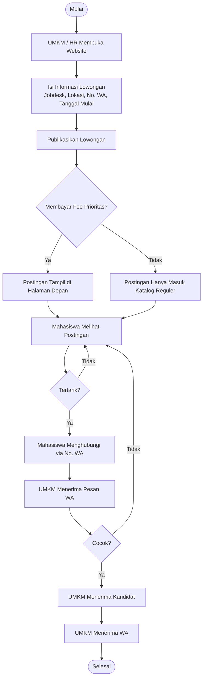

# Sambilan – Platform Tugas Sampingan Mahasiswa & Mitra UMKM

Platform web untuk menghubungkan pelaku UMKM lokal dengan mahasiswa yang mencari pekerjaan sampingan berbasis tugas paruh waktu (*gig task*). Sistem dirancang dengan arsitektur web modern, memadukan frontend responsif dan backend REST API berbasis Express.js serta database SQLite.

---

## 1. Arsitektur Sistem & Struktur Direktori

Proyek menggunakan arsitektur monorepo sederhana di mana backend Node.js menyajikan REST API sekaligus bertindak sebagai static file server untuk antarmuka frontend.

```
tugas 2/
├── index.html                 # Halaman utama aplikasi (portal beranda & katalog)
├── tugas-akhir-pekan.html     # Halaman khusus kurasi tugas akhir pekan (Sabtu & Minggu)
├── tugas-dekat-kampus.html    # Halaman khusus kurasi tugas dekat kampus (radius < 3 km)
├── login.html                 # Halaman mandiri otentikasi mitra UMKM (Login & Register)
├── server.js                  # Entry point Express.js (middleware & static server)
├── db.js                      # Jembatan export database SQLite
├── database.sqlite            # Berkas database SQLite lokal (auto-generated)
├── package.json               # Konfigurasi dependensi & npm scripts
├── src/                       # Backend modular (Clean Architecture)
│   ├── config/
│   │   └── db.js              # Konfigurasi SQLite, schema DDL, & data seeding
│   └── routes/
│       ├── auth.routes.js     # Endpoint otentikasi mitra (Login & Register)
│       ├── tasks.routes.js    # Endpoint lowongan (Katalog, Detail, Pasang Tugas)
│       ├── partners.routes.js # Endpoint daftar mitra UMKM terverifikasi
│       └── applications.routes.js # Endpoint lamaran tugas & kontak WhatsApp
├── css/                       # Gaya antarmuka modular
│   ├── styles.css             # Master stylesheet (mengimpor seluruh sub-modul)
│   ├── variables.css          # Desain tokens, warna resmi, & mode gelap/terang
│   ├── layout.css             # Navbar, footer, tombol, & navigasi tabbar ponsel
│   ├── cards.css              # Hero banner, search bar, kartu tugas & mitra
│   ├── explore.css            # Sidebar filter, filter pills, & empty state
│   ├── modals.css             # Modal dialog tugas, drawer riwayat, & toast feedback
│   └── auth.css               # Desain visual kartu login & formulir registrasi
└── js/                        # Logika frontend
    ├── data.js                # Mock data cadangan untuk mode offline fallback
    └── app.js                 # State management, render antarmuka, & event listeners
```

---

## 2. Alur Operasional Sistem (Flowchart)



Sistem beroperasi berdasarkan alur bisnis dua arah antara UMKM (pemberi kerja) dan Mahasiswa (pencari tugas):

1. **Otentikasi & Pendaftaran Khusus Mitra UMKM (Login & Register)**:
   - Mahasiswa dapat langsung mencari dan menghubungi WhatsApp UMKM tanpa perlu mendaftar atau login (akses publik bebas hambatan).
   - Menu **+ Pasang Lowongan** dan **Masuk Mitra** memicu modal *pop-up* instan di halaman yang sama tanpa me-*reload* atau berpindah laman.
   - Tersedia dua mode: **Login** (untuk mitra terdaftar) dan **Daftar Akun** (untuk registrasi mitra baru).
   - Kredensial akun diverifikasi langsung ke tabel `partners` di SQLite melalui endpoint `POST /api/auth/login` dan `POST /api/auth/register`.
   - Data akun pengujian bawaan di database:
     - **Kopi Senja**: WhatsApp `081234567891` | Sandi `mitra123`
     - **Toko Kue Mawar**: WhatsApp `081234567892` | Sandi `mitra123`
     - **Bengkel Roda Jaya**: WhatsApp `081234567893` | Sandi `mitra123`
   - Mitra baru juga dapat langsung mendaftar dengan menginput Nama Usaha, No. WhatsApp, dan Kata Sandi pada tab **Register**.
2. **Pemasangan Lowongan oleh UMKM**:
   - Setelah masuk, form pasang lowongan otomatis mengunci identitas nama UMKM dan nomor WhatsApp resmi mitra yang sedang aktif.
   - Mengisi informasi posisi: Judul Posisi, Kategori, Jobdesk, Lokasi Usaha, Tanggal Mulai, dan Besaran Honor.
3. **Keputusan Pembayaran Fee Prioritas**:
   - **Membayar Fee Prioritas (Rp25.000)**: Lowongan diberi status `is_featured = 1` dan secara otomatis ditampilkan di bagian utama **Lowongan Prioritas (Halaman Depan)**.
   - **Tanpa Fee (Reguler)**: Lowongan berstatus `is_featured = 0` dan hanya muncul pada katalog pencarian umum.
4. **Pencarian & Kontak Mahasiswa**:
   - Mahasiswa menjelajahi lowongan berdasarkan kategori, jarak terdekat (≤ 2 km), akhir pekan, atau rentang honor.
   - Mahasiswa yang tertarik membuka detail tugas dan menekan tombol **Hubungi via WhatsApp**.
   - Tautan `wa.me` membuka WhatsApp secara otomatis dengan pesan template resmi yang sudah terisi.
5. **Pencatatan Lamaran & Evaluasi**:
   - Sistem mencatat interaksi ke tabel `applications` dengan status awal `pending`.
   - Melalui menu **Tugas Saya**, UMKM dapat melakukan simulasi evaluasi:
     - **Cocok (Terima)**: Status berubah menjadi `accepted`, UMKM menerima kandidat lalu menerima pesan WhatsApp konfirmasi penugasan hingga proses tuntas (*Selesai*).
     - **Tidak Cocok**: Status berubah menjadi `rejected`, mahasiswa diarahkan mencari tugas lain.

---

## 3. Prasyarat Sistem

- **Node.js**: Versi 22.5.0 atau yang lebih baru (menggunakan fitur bawaan `node:sqlite`).
- **NPM**: Versi 10.0.0 atau yang lebih baru.
- Peramban web modern (Google Chrome, Mozilla Firefox, Microsoft Edge).

---

## 4. Panduan Menjalankan Proyek

### A. Menjalankan dengan Backend Terintegrasi (Direkomendasikan)

1. Buka terminal pada direktori proyek (atau hasil clone):
   ```bash
   git clone <URL_REPOSITORY>
   cd sambilan
   ```
2. Pasang dependensi proyek:
   ```bash
   npm install
   ```
3. Jalankan server:
   ```bash
   npm start
   ```
4. Buka peramban pada alamat:
   ```
   http://localhost:3000
   ```
   *(Port dapat disesuaikan via variabel lingkungan `PORT=8000 npm start`)*

*Catatan: Saat pertama kali dijalankan, server akan secara otomatis membuat berkas `database.sqlite` dan mengisi data awal (seeding).*

### B. Menjalankan Mode Frontend Mandiri (Offline / Tanpa Server)

Aplikasi memiliki mekanisme *fallback* otomatis. Berkas `index.html` dapat dibuka langsung melalui protokol berkas lokal (`file:///`) di peramban tanpa menjalankan Node.js. Pada mode ini, penyimpanan data beralih menggunakan `localStorage` peramban.

---

## 5. Dokumentasi REST API

Semua respons API dikembalikan dalam format JSON standar.

### A. Otentikasi & Pendaftaran Mitra

#### `POST /api/auth/login`
Memverifikasi kredensial akun mitra UMKM berdasarkan nomor WhatsApp atau email terdaftar.

- **Request Body**:
  ```json
  {
    "identifier": "081234567891",
    "password": "mitra123"
  }
  ```
- **Response `200 OK`**:
  ```json
  {
    "success": true,
    "partner": {
      "id": 1,
      "name": "Kopi Senja",
      "initials": "KS",
      "brandColor": "#b45309",
      "whatsAppNumber": "081234567891",
      "email": "kopi.senja@sambilan.id",
      "rating": 4.9,
      "taskCount": 2
    }
  }
  ```
- **Response `401 Unauthorized`**:
  ```json
  {
    "error": "Kata sandi salah. Silakan coba lagi."
  }
  ```

#### `POST /api/auth/register`
Mendaftarkan akun mitra UMKM baru ke dalam database SQLite.

- **Request Body**:
  ```json
  {
    "name": "Kedai Kopi Kita",
    "whatsappNumber": "081299887766",
    "password": "password123"
  }
  ```
- **Response `201 Created`**:
  ```json
  {
    "success": true,
    "partner": {
      "id": 6,
      "name": "Kedai Kopi Kita",
      "initials": "KK",
      "brandColor": "#0b63d8",
      "whatsAppNumber": "081299887766",
      "rating": 4.8,
      "taskCount": 0
    }
  }
  ```
- **Response `409 Conflict`**:
  ```json
  {
    "error": "Nomor WhatsApp ini sudah terdaftar. Silakan langsung masuk."
  }
  ```

---

### B. Mitra UMKM

#### `GET /api/partners`
Mengambil daftar mitra UMKM yang terverifikasi beserta jumlah lowongan aktif.

- **Response `200 OK`**:
  ```json
  [
    {
      "id": 1,
      "name": "Kopi Senja",
      "rating": 4.9,
      "initials": "KS",
      "brandColor": "#b45309",
      "taskCount": 2
    }
  ]
  ```

---

### C. Lowongan / Tugas

#### `GET /api/tasks`
Mengambil daftar lowongan yang tersedia. Mendukung filter via *query parameters*.

- **Query Parameters**:
  - `q` (string): Pencarian kata kunci pada judul, lokasi, mitra, atau deskripsi.
  - `category` (string): Slug kategori (`booth`, `sosmed`, `desain`, `konten`, `foto`, `data`).
  - `featured` (boolean `1` atau `true`): Hanya menampilkan lowongan prioritas halaman depan.
  - `near` (boolean `1` atau `true`): Lowongan berjarak ≤ 2 km dari kampus.
  - `weekend` (boolean `1` atau `true`): Lowongan pada hari Sabtu atau Minggu.
  - `hi` (boolean `1` atau `true`): Lowongan dengan honor ≥ Rp100.000.

- **Response `200 OK`**:
  ```json
  [
    {
      "id": 1,
      "title": "Jaga booth bazar kampus",
      "categoryKey": "booth",
      "partnerName": "Kopi Senja",
      "partnerRating": 4.9,
      "stipend": 150000,
      "duration": "4 jam",
      "schedule": "Sabtu, 09.00",
      "availableDays": ["Sab"],
      "distanceKm": 1.2,
      "location": "Kantin Pusat Kampus, Sleman",
      "whatsAppNumber": "6281234567891",
      "startDate": "2026-11-07",
      "isFeatured": true,
      "description": "Jaga booth kopi di bazar kampus..."
    }
  ]
  ```

#### `GET /api/tasks/:id`
Mengambil rincian lengkap dari satu lowongan spesifik.

- **Response `200 OK`**: Objek data tugas tunggal.
- **Response `404 Not Found`**: `{ "error": "Lowongan tidak ditemukan" }`

#### `POST /api/tasks`
Menyimpan postingan lowongan baru dari UMKM.

- **Request Body**:
  ```json
  {
    "title": "Barista Paruh Waktu",
    "categoryKey": "booth",
    "customPartnerName": "Kopi Kulo",
    "stipend": 120000,
    "duration": "4 jam",
    "location": "Jl. Kaliurang KM 5",
    "whatsAppNumber": "6281234567890",
    "startDate": "2026-11-10",
    "isFeatured": true,
    "description": "Membantu operasional bar dan meracik minuman."
  }
  ```
- **Response `201 Created`**:
  ```json
  {
    "success": true,
    "taskId": 11,
    "isFeatured": true
  }
  ```

---

### D. Lamaran & Riwayat Kontak

#### `GET /api/applications`
Mengambil seluruh riwayat kontak dan status lamaran.

- **Response `200 OK`**:
  ```json
  [
    {
      "id": 1,
      "taskId": 1,
      "taskTitle": "Jaga booth bazar kampus",
      "stipend": 150000,
      "location": "Kantin Pusat Kampus, Sleman",
      "whatsAppNumber": "6281234567891",
      "partnerName": "Kopi Senja",
      "stageIndex": 1,
      "candidateStatus": "pending"
    }
  ]
  ```

#### `POST /api/applications`
Mencatat pelamar yang telah menghubungi UMKM via WhatsApp.

- **Request Body**:
  ```json
  {
    "taskId": 1
  }
  ```
- **Response `201 Created`**:
  ```json
  {
    "success": true,
    "id": 1,
    "taskId": 1,
    "stageIndex": 1,
    "candidateStatus": "pending"
  }
  ```

#### `PATCH /api/applications/:id`
Memperbarui tahapan alur seleksi kandidat oleh UMKM.

- **Request Body**:
  ```json
  {
    "candidateStatus": "accepted"
  }
  ```
- **Response `200 OK`**: `{ "success": true }`

---

## 6. Skema Database (SQLite)

### Tabel `partners`
Menyimpan profil UMKM yang terverifikasi dalam sistem.
- `id` (INTEGER, Primary Key, Autoincrement)
- `name` (TEXT, Not Null): Nama usaha/UMKM
- `rating` (REAL): Skor ulasan (skala 1.0 - 5.0)
- `initials` (TEXT): Inisial badge profil
- `brand_color` (TEXT): Kode warna identitas hex
- `whatsapp_number` (TEXT, Unique): Nomor WhatsApp resmi untuk login dan kontak
- `password` (TEXT): Kata sandi akun mitra
- `email` (TEXT): Alamat email resmi mitra / PIC usaha

### Tabel `tasks`
Menyimpan data lowongan pekerjaan sampingan.
- `id` (INTEGER, Primary Key, Autoincrement)
- `title` (TEXT, Not Null): Judul pekerjaan
- `category_key` (TEXT, Not Null): Kategori pekerjaan
- `partner_id` (INTEGER, Foreign Key): Referensi ke tabel `partners`
- `custom_partner_name` (TEXT): Nama UMKM jika dipasang oleh UMKM non-rekanan
- `stipend` (INTEGER, Not Null): Besaran honor dalam Rupiah
- `duration` (TEXT): Estimasi lama waktu kerja
- `schedule` (TEXT): Keterangan jadwal
- `available_days` (TEXT): JSON array hari kerja aktif
- `distance_km` (REAL): Jarak dari kampus dalam kilometer
- `location` (TEXT, Not Null): Alamat lengkap lokasi kerja
- `whatsapp_number` (TEXT, Not Null): Nomor kontak WhatsApp UMKM
- `start_date` (TEXT, Not Null): Tanggal mulai kerja
- `is_featured` (INTEGER): Status prioritas (1 = Ya / Fee Terbayar, 0 = Reguler)
- `description` (TEXT, Not Null): Rincian deskripsi tugas
- `created_at` (DATETIME): Waktu posting dibuat

### Tabel `applications`
Menyimpan riwayat kontak dan evaluasi kandidat.
- `id` (INTEGER, Primary Key, Autoincrement)
- `task_id` (INTEGER, Foreign Key): Referensi ke tabel `tasks`
- `stage_index` (INTEGER): Tahap status alur (0: Kontak WA, 1: WA Diterima, 2: Evaluasi, 4: Selesai)
- `candidate_status` (TEXT): Status kandidat (`pending`, `accepted`, `rejected`)
- `created_at` (DATETIME): Waktu lamaran dibuat

---

## 7. Cara Membuka & Mengelola Database (SQLite)

Berkas `database.sqlite` adalah database lokal berkas tunggal yang dapat dibuka dan dipantau melalui beberapa cara:

1. **Ekstensi VS Code (SQLite Viewer)**:
   - Instal ekstensi **SQLite Viewer** (Florian Klampfer) melalui panel Extensions (`Ctrl + Shift + X`).
   - Klik berkas `database.sqlite` di explorer file VS Code untuk membuka tabel secara visual.
2. **Aplikasi Desktop GUI (DB Browser for SQLite)**:
   - Unduh dari situs resmi `https://sqlitebrowser.org/dl/`.
   - Buka aplikasi dan pilih menu **Open Database** -> arahkan ke berkas `database.sqlite`.
3. **Kueri Cepat via Terminal**:
   - Menampilkan isi tabel lowongan langsung di terminal:
     ```bash
     node -e "const db = require('./db.js'); console.table(db.prepare('SELECT id, title, stipend, is_featured, location FROM tasks').all());"
     ```

---

## 8. Fitur Frontend & Desain

- **Desain Bebas Komponen Slop**: Tipografi optik *Plus Jakarta Sans*, tata letak grid asimetris dengan spasi terukur, tanpa gradient neon atau efek glow dekoratif yang tidak perlu.
- **Dukungan Mode Terang & Gelap**: Menggunakan palet presisi hasil ekstraksi visual. Mode terang memakai gradasi *sky blue* lembut (`#d4e8ff` ke `#edf5fe`), dan mode gelap memakai warna pekat *midnight* (`#0c1524` dan `#132035`).
- **Aksesibilitas & Standar Web**: Validasi semantik HTML5 (`<header>`, `<main>`, `<section>`, `<article>`, `<aside>`), navigasi keyboard, dan pemenuhan kontras warna WCAG AA.

